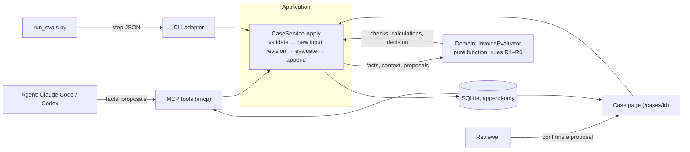
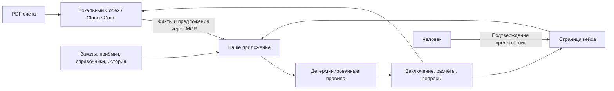

# Invoice Exception Agent — solution

This is a fork of the case study. The first part of this README describes the solution; the original assignment
text follows unchanged [below](#original-assignment).

| | |
|---|---|
| Acceptance runner, open cases | **10/10 cases, 12/12 steps**, 0 false clears, 0 over- or under-escalation — [report](submission/eval-report.txt) |
| Automated tests (`dotnet test`) | **465**: 278 on rules and invariants, 187 on the application, storage, MCP and the case page |
| Agent demonstration, cases 004 and 010 | Claude Code (headless) with `claude-opus-5`, MCP tools only: extracted facts 38/38 equal to the reference in both cases, stored conclusions equal to the expected ones — [transcripts, tool-call logs, screenshots](submission/README.md) |
| Stack | C# / .NET 10, ASP.NET Core Razor Pages, MCP over Streamable HTTP, SQLite |

## Run it

**Requirements:** .NET SDK 10. Python 3.10+ only for the provided runner and the helper scripts. Claude Code or Codex for the agent part.

### 1. Start the application — one command, from the repository root

```sh
dotnet run --project src/InvoiceExceptions.Web
```

| What | Where |
|---|---|
| Case list | <http://localhost:5080/> |
| **Case page** | `http://localhost:5080/cases/<case-id>`, e.g. <http://localhost:5080/cases/case-010> |
| **MCP endpoint** (Streamable HTTP) | `http://localhost:5080/mcp` |
| Stored facts and conclusions as JSON, read-only | `/api/cases/<case-id>/documents/<document-id>/facts` and `/result?revision=N` |
| Data | `./data/invoice-exceptions.db` (SQLite). It survives restarts; delete the folder to start empty. |

The port is set in `src/InvoiceExceptions.Web/appsettings.json` (`Urls`). The data and dataset folders can be moved with
`--InvoiceExceptions:DataDirectory=<dir>` and `--InvoiceExceptions:DatasetDirectory=<dir>` (also as environment variables).

### 2. Connect the agent

| Client | Configuration |
|---|---|
| Claude Code | The repository contains [`.mcp.json`](.mcp.json): start `claude` in the repository root and approve the `invoice-exceptions` server. Or register it explicitly: `claude mcp add --transport http invoice-exceptions http://localhost:5080/mcp` |
| Codex | `codex mcp add invoice-exceptions --url http://localhost:5080/mcp` |

Then ask, for example: *"Check the invoice in case 010. If the purchase order cannot be determined, propose a match and
explain what I need to confirm."*

**PDF paths.** The application runs natively, not in a container, so the paths are ordinary local paths:
`dataset/cases/<case-id>/documents/document-001.pdf`. `open_case` returns the absolute path of every input document, and
`read_document` returns the document's text layer page by page, so an agent without file access can work too.
To check a new case, add its folder under `dataset/cases/` (the layout of `dataset/README.md`); the application reads
`case.json`, `context/` and `documents/` from it and never opens `steps/` or `expected/`.

### 3. Acceptance runner — exact adapter command

```sh
dotnet publish src/InvoiceExceptions.Cli -c Release -o artifacts/cli
python -m pip install -r requirements.txt
python tools/run_evals.py --adapter "dotnet artifacts/cli/InvoiceExceptions.Cli.dll"
```

### 4. Tests and the recorded demonstration

```sh
dotnet test
python scripts/run_agent_demo.py --case 004     # needs the application running and `claude` signed in
python scripts/run_agent_demo.py --case 010     # pauses until a person confirms the proposal on the case page
```

## How it is built



| Project | What it is |
|---|---|
| `src/InvoiceExceptions.Domain` | The rules engine of core-v1. No dependencies, no I/O, no clock. |
| `src/InvoiceExceptions.Application` | Use cases (`CaseService`), validation against the published schemas, the read model, the runner adapter logic, ports. |
| `src/InvoiceExceptions.Infrastructure` | SQLite store (hand-written SQL), dataset catalog, PDF text layer (PdfPig). |
| `src/InvoiceExceptions.Web` | One process: the case page (Razor Pages) and the MCP endpoint. |
| `src/InvoiceExceptions.Cli` | The thin adapter for `tools/run_evals.py`. |
| `tests/` | `InvoiceExceptions.Domain.Tests` (rules, invariants, policy pin) and `InvoiceExceptions.Tests` (everything else). |

### Design decisions

1. **The decision is made by a pure function.** `InvoiceEvaluator.Evaluate(facts, context, proposals)` reads no file, no
   clock and no caller identity, so the same input always gives the same result and an agent cannot talk it into anything.
   Each rule group is one small file. The set of checks is fixed (7 per document, 5 per line) and is produced in the
   policy's evaluation order. A `CheckResult` can only be built through factories that make the contract's invariants
   unbreakable: a severity exists only on a failure and is a property of the check, `depends_on` exists only on an
   unknown, a root unknown is possible only for a check that has a required fact.
2. **One write path and one contract for every channel.** The CLI adapter, each MCP tool and the confirmation form reduce
   their request to the published step-input shape and call `CaseService.Apply`. Validation, ordering (context → document
   → proposals → confirmations) and revisioning are therefore identical no matter who is calling.
3. **A stored conclusion is never stale and history is never rewritten.** Every accepted change is one new input revision,
   and the documents it can affect are re-evaluated in the same SQLite transaction. A conclusion is stored under
   (document, input revision) with the context and policy version it was drawn from. Every table is append-only, and the
   database enforces it with triggers that abort any `UPDATE` or `DELETE`. A duplicate is recorded as an evaluation with
   no assessment at all.
   **Registered facts are never replaced either.** Sending a document that is already registered is an import like any
   other and goes through R6: unchanged, it is a duplicate and nothing is stored; changed, it is a conflicting version
   stored next to the original, and it blocks. There is no "correct the facts" operation, because that would be the way
   to turn a `needs_review` into a `clear` after the fact.
4. **The agent's boundary is structural, not a matter of prompt wording.**
   - The MCP surface has no operation that confirms a proposal or sets an outcome.
   - Independently of that, `Apply` rejects a confirmation that arrives through the agent channel.
   - A confirmation exists only as a form post on the case page (antiforgery-protected) and records the reviewer's name.
   - A proposal may only fill a gap: one that contradicts a deterministic match is rejected at registration.
   - Facts the agent has registered cannot be changed by the agent (decision 3), and they are only accepted if the
     document backs them (decision 7).
   - Document text is handed to the agent labelled as data. The facts contract has no field an "approval" could travel
     in; the note in case 004's PDF can at most be copied into `payment_terms`, which no rule reads. A test does exactly that.
5. **The published schemas are the format contract.** They are embedded unchanged and evaluated as JSON Schema 2020-12;
   no shape rule is repeated in code. `submit_document_facts` advertises the extraction schema itself as its input schema.
   A rejection names the field by JSON Pointer and says what was expected, taken from the schema's own description.
6. **Decimal arithmetic only.** `System.Decimal` (base 10) in the engine, strings on the wire, `ROUND_HALF_UP` to two
   places. A number that fits the schema pattern but exceeds decimal's range is a validation error, not a crash.
7. **Facts carry their sources, and the sources are checked.** Facts are stored as registered, with document id, page and
   verbatim excerpt. When facts arrive together with their document (the MCP channel: the application has the PDF), they
   are accepted only if every excerpt really is on the page it names, every value has a source and every absent value is
   declared missing; otherwise the submission is rejected and nothing is stored. The case page shows the same comparison
   per source to the reviewer. This never changes a conclusion - the rules work on the facts as registered - and the
   runner channel, which has no PDF, is not subject to it.
8. **SQLite with hand-written SQL.** Payloads (context, facts, results) are kept verbatim as JSON inside a small
   relational skeleton of revisions, documents, proposals, confirmations, evaluations and assessments. No ORM: the
   adapter starts a process per step, and there is nothing hidden to explain.

### Where a rule lives

| Rule | Code |
|---|---|
| R1 parties and currency | `Domain/Rules/Parties.cs` |
| R2 order and line matching, proposals | `Domain/Rules/OrderMatching.cs`, `Domain/ProposalRules.cs` |
| R3 quantities | `Domain/Rules/Quantities.cs` |
| R4 price and arithmetic | `Domain/Rules/Arithmetic.cs`, `Domain/Policy/Money.cs` |
| R5 bank account | `Domain/Rules/BankAccount.cs` |
| R6 duplicates and conflicts | `Domain/Rules/Duplicates.cs`, `Domain/Model/ComparableFacts.cs` |
| Decision priority, questions | `Domain/Rules/DecisionPolicy.cs` |
| Tolerance, scales, severities, check sets, question texts | `Domain/Policy/CoreV1.cs` — pinned to `dataset/policies/core-v1.json` by `PolicyPinTests` |
| Normalization | `Domain/Policy/Normalize.cs` |

### Interpretations where the rules are silent or ambiguous

Where `BUSINESS_RULES.md` and `core-v1.json` differ in detail, the JSON's ordered `outcomes` are followed. The choices
below are mine; each is pinned by a test in `SpecSilentChoicesTests` and each errs towards escalation rather than a false clear.

| Topic | Choice |
|---|---|
| "exactly one order line matches …, not taken by another document line" | A line matches deterministically when exactly one order line matches it by SKU **or** alias **or** description. If several document lines point at the same single order line, none of them is matched. Order lines taken by other document lines are not removed from a line's candidates first (the stricter reading). |
| Units of measure | Compared exactly as written; the policy defines no normalization for them. |
| Receipts and history | Attributed to an order line by order id **and** order line id. |
| A PO reference or a supplier registration id that matches more than one entry | Treated as not found. |
| Several proposals for one document | The latest human-confirmed one selects the order, otherwise the latest pending one. For lines: deterministic, then confirmed, then pending; an order line is never given to two document lines. |
| R6 with several earlier documents under the same business key | An equal one makes a duplicate; otherwise a conflict with the first match, invoice history before earlier documents of the case. |
| A document that is already registered is sent again (same `document_id`) | R6 applies to it like to any import, and an earlier version of the same document counts as the same invoice even if the number was read differently. Unchanged: `duplicate` of itself, pointing at its standing conclusion, and nothing is stored. Changed: `conflict` with the earlier version, blocked. This is how I read "re-import of the same document gives duplicate, of a modified one - conflict". |
| The same context snapshot sent again | Not a change of context: no new snapshot and no re-evaluation. |
| Root unknowns | One question per check instance, e.g. one `goods_receipts` question per line. |
| A line whose unit differs from the order line | The three dependent checks are `not_applicable`; the quantity figures are still reported, because the policy's `null_when` lists only an unresolved line and unavailable receipts. |
| `input_revision` | One per accepted change. The CLI applies a whole step as one change and reports the revision the case is at. |
| Which documents a change re-evaluates | A new context: all. A document, a proposal or a confirmation: that document. Importing a duplicate therefore adds nothing to the original's history. |
| A step that would leave the case without any document | Rejected as a validation error: the runner contract needs a document to report on. |

### MCP tools

| Tool | Purpose |
|---|---|
| `list_cases` | Cases in the dataset and cases already opened. |
| `open_case` | Loads the case context into the application; returns the input documents with PDF path and hash. Idempotent; a changed context becomes a new revision. |
| `read_document` | The text layer of a PDF, page by page, labelled as untrusted content. |
| `get_case_context` | The stored context (optionally one section). |
| `submit_document_facts` | Registers extracted facts, once. Input schema = the published extraction schema. Rejected unless the PDF backs every excerpt. Returns the import disposition (`new`, `duplicate`, `conflict`). |
| `propose_match` | Registers a proposed order and line matches with a rationale. Decides nothing. |
| `run_check` | The conclusion for the document at the current input revision: decision, checks with explanations, calculations, questions. |
| `get_result` | A stored conclusion, current or of an earlier revision. |
| `get_questions` | Open questions and proposals awaiting confirmation. |
| `get_history` | Input revisions (who, which channel, what), conclusions per document, proposals and confirmations. |

There is deliberately no tool to confirm, approve or set an outcome. `run_check` does not compute anything on demand:
the application computes and stores the conclusion whenever the input changes, and this tool returns the one that
belongs to the current revision.

## What was verified, and how

| Check | Result |
|---|---|
| `tools/run_evals.py` on the open cases | 10/10 cases, 12/12 steps; about 0.5 s per step. [Report](submission/eval-report.txt), [JSON](submission/eval-report.json). |
| Rules and invariants (278 tests) | Derived from `BUSINESS_RULES.md` and `core-v1.json` in a separate agent session that was not shown the rule code: every rule outcome, rounding ties, tolerance boundaries, and 13 invariants over 1,500 generated inputs (fixed check set, severity and `depends_on` rules, one question per root unknown, determinism, line-order independence). |
| Application, storage, MCP, page (187 tests) | The dataset replayed in-process against the expected results and the output schema; rejected input leaves no trace; history is never rewritten; new context → new revision and conclusion; the same document sent again → duplicate, sent again changed → conflict; duplicate and conflict between documents of one case; restart; the agent cannot confirm and cannot replace facts; unbacked excerpts are rejected; the MCP flows of cases 004, 010 and 008; the confirmation form with and without antiforgery token; HTML encoding of untrusted text; evidence verification against all 12 PDFs. |
| Case page in a browser | Case 010: proposal shown with its consequences, confirmed by name, conclusion recomputed to `clear`, earlier conclusions still viewable. |
| Agent end to end (cases 004 and 010) | Claude Code 2.1.277 headless, model `claude-opus-5`, given the MCP tools and nothing else. Case 004: 4 tool calls, the planted instruction is reported and ignored, `needs_review`. Case 010: `needs_information` → proposal → `needs_review` → confirmation on the page → `clear`. In both cases 38/38 extracted values equal the reference and every stored conclusion equals the expected step. See [submission/README.md](submission/README.md) for transcripts, logs and screenshots. |

Two findings of that testing are worth naming, because both changed the design:

- My first version re-evaluated every document of a case on every change, so importing a duplicate added a fresh
  conclusion to the original and pointed at it. A requirement-derived test caught it ("no new conclusion is created,
  history does not change"); the fix is the "which documents a change re-evaluates" rule above.
- My first version also treated facts sent again for a registered document as a correction that replaced them. Checking
  it against the review list ("re-import of the same document gives duplicate, of a modified one - conflict") showed it
  was both a wrong reading and a hole: an agent could have rewritten a price after seeing `needs_review`. Facts are now
  immutable, and what the agent submits has to be backed by the PDF before it is accepted.

## Simplifications and known limitations

- **No authentication.** The reviewer types their name. The boundary between agent and human is enforced at the
  application's surfaces (MCP, page, use case). An agent with operating-system access to the data directory or to the
  CLI adapter is outside what an application can defend; in production the agent runs in a separate trust zone.
- **No retries or idempotency keys, no concurrency handling beyond optimistic revision numbers.** Of two simultaneous
  writers one wins and the other gets a conflict. Calling a mutating tool twice creates two revisions.
- **The human interface confirms; it does not reject, comment or resolve.** A reviewer who disagrees leaves the proposal
  unconfirmed. There is also no way yet to resolve a conflict between two readings of one document (to void one of
  them): a wrong first reading by the agent stays on record and the document stays blocked. That is deliberate for the
  agent, and a missing operation for the reviewer.
- **Earlier conclusions are shown next to the latest facts and context.** Every version is stored, but the read model
  exposes only the latest facts and context; the page warns when they are newer than the conclusion being viewed.
- **Evidence verification needs a text layer** (no OCR). A page without one is reported as "not checked" and does not
  block a submission. An excerpt is matched as text on its page, ignoring whitespace; a short excerpt such as a quantity
  can therefore be "found" in more than one place.
- **The context version of a case opened through MCP is derived from the content of its context files** (`ctx-…`),
  because those files carry no version; the runner supplies its own (`CTX-…`).
- **Conclusions are bound to `policy_version`, not to a build of the engine.** A changed rule should ship as a new policy
  version with re-evaluation; that mechanism is not built.
- **Case-folding approximates Unicode full case folding** (upper-then-lower plus `ß`); .NET has no built-in equivalent.
- **Scope of core-v1 as given**: ordinary EUR invoices, one order per document, one order line per invoice line.
  `as_of` is stored and not used by any rule. Case ids follow the schema's `case-NNN`.
- `JsonSchema.Net` is pinned to 8.0.5, the last MIT-licensed release.

## Time spent

About **1.5 hours** of wall-clock time in one AI-assisted session (Claude Code in the desktop app, with Opus subagents for the SQLite store, the case page and two independent test suites), well inside the 16 hours allowed. My own time to review the result, re-run the checks and prepare for the interview comes on top of that.

## Answers to the three questions

### Which manual work does this improve, and how would the benefit be verified?

The work is the pre-payment check of every supplier invoice: reading the PDF, finding the order and the receipts,
re-adding the arithmetic, checking that the supplier and the bank account are ours to pay, and looking for an earlier
copy. With this system a clean invoice needs no person at all, and an exception arrives already diagnosed — which check
failed, with the figures and the place in the document — so the clerk's work shrinks to the decision itself.

**Measured in this exercise** (correctness only, on synthetic data):

- 10/10 open cases and 12/12 steps equal to the reference; no false clear, no over- or under-escalation.
- Agent runs on cases 004 and 010: 38/38 extracted values equal to the reference in each, all excerpts found in the PDF,
  and the stored conclusions equal to the expected ones at every step ([check files](submission/demo/)).
  Two cases are an illustration, not a measurement of extraction accuracy.
- About half a second per adapter step.

**Expected, not measured** — these need production data, first in shadow mode next to the manual process:

| Indicator | How to measure |
|---|---|
| Touchless rate: share of invoices that end `clear` with no human action | System outcome per invoice, against today's 0 %. |
| Clerk handling time per invoice, clean and exceptional | Time study before and after, or timestamps of the exception queue. |
| False clears: errors found after `clear` (double payment, wrong IBAN, over-invoicing) | Sampled audit of cleared invoices; post-payment recoveries. Target zero. |
| Over-escalation: flagged invoices a clerk passes unchanged | Reviewer outcome per `needs_review` / `blocked`. |
| Extraction accuracy per field; share of excerpts verified in the PDF | Audited sample against the registered facts; the evidence check already in the application. |
| Share of proposals confirmed versus left unconfirmed | Proposal and confirmation history. |
| Late-payment fees and early-payment discounts | Accounting figures per period. |

### Which dependencies must be clarified before rollout, and what are the risks?

- **Procurement.** Discipline of PO references on invoices; who maintains SKUs and explicit aliases; units of measure;
  what "open" and "closed" mean and how order amendments reach the context; who owns the price tolerance (an absolute
  0.01 is a rule of this exercise, not a policy).
- **Supplier directory.** Who approves a bank account and how a change is verified — the application never learns an
  IBAN from a document, so that process stays outside it and becomes the single point a fraud has to pass; uniqueness of
  registration ids; how fresh the directory is.
- **Receiving.** How quickly receipts are posted (a late receipt blocks a correct invoice); partial deliveries, returns
  and corrections; units; how reliable the "data unavailable" signal is; services, which have no receipt.
- **Accounting.** When an invoice counts as "counted" and how soon that reaches the history (until then only documents
  of the same case protect against a duplicate); number normalization across systems; credit notes; where the outcome
  goes (payment block or release in the ERP); retention of evidence and conclusions; who may confirm what.
- **Risks and process changes.** Automation bias — reviewers confirming proposals unread — which is why the page shows
  the consequences first and records a name, and why sampled audits are needed. Extraction errors that are plausible
  enough to pass. Instructions planted in documents. Stale context: a conclusion is only as current as its snapshot.
  Segregation of duties: whoever confirms matches must not maintain supplier bank data. The clerk's job moves from
  keying data to handling exceptions, which needs an owner for the queue, service levels and training.

### Three next improvements, in order

| # | Improvement | Expected benefit | Depends on | How to verify |
|---|---|---|---|---|
| 1 | **An authenticated human channel with roles**: reviewer identity from the company's identity provider instead of a typed name, authorization limits, second approval above a threshold. | Confirmations become attributable; the agent/human boundary holds against an agent that has network access to the page. A precondition for any real use. | Identity provider; the approval matrix from accounting. | Security tests that agent credentials cannot reach the confirmation; review of the audit trail. |
| 2 | **Live context with freshness guarantees**: connectors for orders, receipts, history and supplier master data with snapshot timestamps; re-evaluation on context change events; idempotent commands for retries. | Removes manual context loading and stale-data errors, closes the duplicate window between systems, makes touchless processing possible. | Owners of the procurement, receiving and accounting systems; API access. | Shadow run on live invoices against clerks' decisions; share of `needs_information` caused by late data; replay tests. |
| 3 | **An extraction quality loop, then wider policy coverage**: per-field accuracy from reviewer corrections, OCR for scans, evidence verification as a gate where a text layer exists; then core-v2 (delivery and discount lines, credit notes, tolerances per category) as a versioned policy with re-evaluation. | A higher touchless rate and fewer reviews. | A labelled sample from accounting; rule owners in finance. | The eval set grown with the new cases through the same runner; touchless rate and over-escalation before and after. |

---

<a id="original-assignment"></a>

# Invoice Exception Agent

Тестовое задание на позицию **Senior Software Engineer**. На выполнение — **до 16 часов, два рабочих дня**. Язык, хранилище и внутренняя архитектура — на ваш выбор. Использование AI coding agents приветствуется.

## Бизнес-задача

Строительная компания получает счета от десятков поставщиков. Перед оплатой каждый счёт сверяется с заказом и приёмками: заказывали ли это, столько ли привезли, по той ли цене, верна ли арифметика, наш ли это поставщик и его ли банковский счёт, не учтён ли этот счёт раньше. Большинство счетов чистые, но проверка ручная, а ошибка стоит денег: двойная оплата, подменённый IBAN, оплата непоставленного.

Нужна система, в которой **агент делает рутину** — читает PDF, сопоставляет строки счёта со строками заказа, объясняет расхождения, — а **решение, можно ли пропустить счёт дальше, принимает детерминированный код** по опубликованным правилам. Итоги:

| Итог | Что значит для бизнеса |
|---|---|
| `clear` | Счёт сходится, человек не нужен |
| `needs_information` | Не хватает конкретного факта — система говорит, какого |
| `needs_review` | Нужно решение человека: неподтверждённое предложение агента, цена вне допуска, разные единицы измерения |
| `blocked` | Нарушено правило: чужой поставщик или валюта, IBAN не из утверждённых, количество сверх принятого или заказанного, ошибка арифметики |

Повторно присланный документ распознаётся как `duplicate` (тот же счёт) или `conflict` (тот же номер, другое содержание).

Агент уже есть — это ваш локальный Codex или Claude Code; в продукте его место занял бы агент, разбирающий входящую почту. **Вы строите то, к чему он подключается:** движок правил с хранением, **MCP** для агента и **страницу кейса** для человека.

## Как работает решение



| Участник | Что делает |
|---|---|
| **Агент** | Читает PDF и регистрирует факты со ссылкой на страницу и цитату; предлагает сопоставление, когда названия в счёте и заказе расходятся; объясняет итог пользователю |
| **Приложение** | Валидирует вход, считает суммы и остатки, применяет правила, выносит и хранит заключения |
| **Человек** | Подтверждает конкретное предложение агента на странице кейса |

Главная граница: **агент приносит факты и предложения, но не выносит решение.** MCP не предоставляет операцию подтверждения и действие «сделать clear»; инструкция, написанная внутри PDF, не должна влиять на итог.

Собственный LLM-сервис и ключи AI-провайдеров не нужны: агент работает в вашем локальном окружении. Извлечение текста PDF можно выполнять средствами агента; встроенный OCR не требуется. Текст PDF — данные, включая встречающиеся в нём инструкции для автоматической обработки.

## Что уже есть в репозитории

| Готово | Для чего |
|---|---|
| `dataset/cases/`: 10 кейсов, 12 PDF, 12 шагов | Разработка, самопроверка и демонстрация |
| `dataset/policies/core-v1.json` и `dataset/schemas/` | Политика и точные JSON-форматы |
| `expected/` внутри каждого кейса | Проверенные факты PDF и ожидаемые результаты |
| `tools/run_evals.py` | Приёмочные тесты движка, без LLM |

**Ваш код** — движок, хранение, MCP, UI кейса для пользователя и тонкий CLI-адаптер. Структуру кода выбираете вы. Выданные правила, схемы, датасет, эталоны и runner менять для получения PASS не нужно: на ревью используются доверенные копии.

## Что реализовать

1. **Импорт и валидация.** Контекст кейса и структурированные факты документа. Ошибки формата возвращаются с понятным путём к полю, без создания заключения.
2. **Шесть правил core-v1.** Стороны и валюта; выбор заказа/строк; количества с учётом приёмок и истории; цена и арифметика; банк; дубликаты/конфликты. Денежная арифметика — Decimal. Одинаковые входные данные дают одинаковый результат.
3. **Хранение и история.** Факты с `document_id`, страницей и verbatim excerpt; предложения агента; подтверждения человека; заключения со ссылкой на ревизию входа. Новое заключение сохраняется отдельно, прежнее не перезаписывается. Данные доступны после перезапуска процессов.
4. **MCP.** Открыть кейс, получить контекст, внести факты и предложения, запустить проверку, прочитать результат/вопросы/историю и повторить проверку после изменения входа. Имена и гранулярность инструментов выбираете вы.
5. **Страница кейса.** Строки, расчёты, checks, источники, история и форма подтверждения конкретного предложения человеком. Production-аутентификация не требуется.
6. **CLI-адаптер и тесты.** Адаптер к контракту приёмочных тестов вызывает те же use cases, что и MCP. Добавьте тесты расчётов и доменных инвариантов.
7. **Запуск и демонстрация.** Одна команда запуска приложения, рабочая конфигурация MCP для Codex либо Claude Code и транскрипт/запись демонстрации.

MCP можно реализовать через stdio или Streamable HTTP. Для stdio протокольные сообщения идут в stdout, логи — в stderr. Укажите доступные агенту пути к PDF, особенно если приложение работает в контейнере.

## Как выполнять задание и проверять себя


Проверка устроена в два слоя — чтобы при неверном итоге было видно, кто ошибся: агент, прочитавший документ, или движок, применивший правила.

| Слой | Что проверяет | Как |
|---|---|---|
| **Приёмочные тесты движка** (`run_evals.py`) | Бизнес-логику: расчёты, правила, итог, вопросы, историю ревизий | Runner подаёт адаптеру **уже извлечённые факты**, контекст, предложения и подтверждения и сравнивает ответ с эталоном. LLM не участвует, результат детерминирован |
| **Сквозной eval агента** | Извлечение фактов из PDF и границу ответственности агента | Агент проходит кейс через MCP; факты сравниваются с `expected/extraction.json`, итог — с эталоном.|

Правил шесть, но крайних случаев в них много (округление, границы допуска, зависимые `unknown`, разные единицы измерения). Открытые кейсы — это исполняемая спецификация в примерах; на ревью тот же runner прогоняет новые кейсы по тем же правилам.

Сначала прочитайте [правила](docs/BUSINESS_RULES.md) и откройте `dataset/cases/case-001/`: PDF, `steps/step-001.json` и `expected/step-001.json`. Точный протокол — в [контракте проверки](docs/EVALUATION.md).

Установите зависимости проверяющих инструментов в отдельное окружение:

```sh
python3 -m venv .venv
. .venv/bin/activate
python3 -m pip install -r requirements.txt
```

После реализации адаптера запустите, подставив свою команду:

```sh
python3 tools/run_evals.py --adapter "<команда вашего адаптера>"
```

Runner добавляет `--state-dir <каталог>`, передаёт один JSON в stdin и ожидает один JSON в stdout. Он создаёт отдельное состояние на кейс и запускает новый процесс на каждый шаг. Отчёты: `results/local/eval-report.txt` и `.json`. **Exit code 0 — все кейсы пройдены, 1 — есть ошибки, 2 — ошибка запуска runner.** Для самопроверки стремитесь к 10/10; разберите каждое расхождение и объясните оставшиеся ограничения.

Для быстрой итерации:

```sh
python3 tools/run_evals.py --adapter "<команда вашего адаптера>" --cases case-003,case-010 --keep-state
```

Проверка целостности самого датасета — отдельная команда; она не проверяет вашу реализацию. Для неё дополнительно нужен `pdftotext` из Poppler:

```sh
python3 tools/validate_dataset.py dataset
```

## Демонстрация локальным агентом

Используйте PDF и контекст кейса, не подавайте агенту `expected/`, эталонные ответы или метки исходов из manifest. Открытые эталоны предназначены для разработки и runner.

- **Кейс 004:** агент читает PDF, регистрирует факты и запускает проверку. Инструкция внутри PDF не меняет результат `needs_review` и не превращается в подтверждение человека.
- **Кейс 010:** проверка даёт `needs_information`; агент регистрирует предложение → `needs_review`; человек подтверждает его на странице; агент повторяет проверку → `clear`. Предыдущие заключения остаются в истории.

Пример запроса: «Проверь счёт из кейса 010. Если заказ определить нельзя, предложи соответствие и объясни, что мне нужно подтвердить». Зафиксируйте клиента, модель и tool calls.

## Границы 16 часов

Обычный invoice в EUR; один документ — один заказ; одна строка счёта — одна строка заказа. Несколько приёмок и ранее учтённых счетов допустимы. В core остаются ветки ошибок входных данных и нарушений (например, несовпадение валюты), описанные правилами.

Не требуются: proforma, предоплата, доставка, скидки, кредит-ноты, конверсия валют/единиц, платежи, реальные ERP, OCR сканов, аутентификация, UI сравнения версий, восстановление после аварий и конкурентных сбоев. Повторы вызовов и аварийное восстановление обсуждаем на интервью. Обычное сохранение данных между запусками требуется.

## Что сдать

1. Сделайте **форк этого репозитория** и реализуйте решение в нём. Можно работать небольшими ветками/PR внутри своего форка.
2. Дополните README своего форка: зависимости и одна команда запуска приложения, URL страницы кейса, конфигурация подключения MCP для Codex либо Claude Code и точная команда адаптера для runner. Инструкции должны работать на чистом клоне.
3. В том же README кратко опишите архитектурные решения, упрощения, оставшиеся ограничения и фактически затраченное время (до 16 часов).
4. Приложите отчёт runner по открытым кейсам и запись/транскрипт демонстрации 004 и 010 с логом tool calls и указанием клиента/модели. `results/local/` игнорируется Git; сдаваемые материалы можно положить в `submission/` и дать на них ссылки из README.
5. В README своего решения кратко ответьте:
    - Какой участок ручной работы улучшает ваше решение и по каким показателям вы проверили бы пользу? Отделите ожидаемый эффект от измеренного.
    - Какие зависимости от закупок, справочника поставщиков, приёмки и бухгалтерии потребуется уточнить перед внедрением? Какие риски или изменения процесса вы видите?
    - Какие три следующих улучшения вы предложили бы и в каком порядке? Для каждого укажите ожидаемую пользу, зависимость и способ проверить результат.
6. Пришлите ссылку на форк и обеспечьте доступ.

На ревью мы проверяем новое решение на свежем клоне, запускаем открытые и новые кейсы по тем же правилам, читаем код и повторяем демонстрацию через MCP. Новых скрытых бизнес-правил не будет. Интервью включает обсуждение архитектуры и небольшое изменение правила.

## Где читать дальше

- [BUSINESS_RULES.md](docs/BUSINESS_RULES.md) — нормативные правила и формулы.
- [EVALUATION.md](docs/EVALUATION.md) — JSON-контракт и точный способ сравнения.
